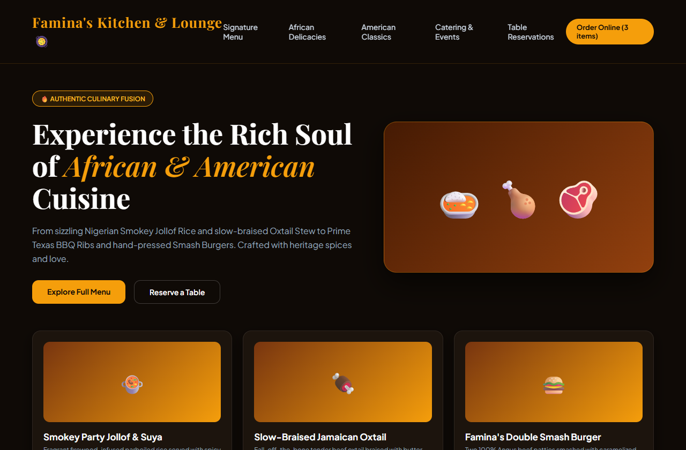

# Famina's Kitchen & Lounge 🥘
### Authentic African & American Culinary Experience & Ordering Web Platform

A production-grade full-stack restaurant web application delivering a rich culinary fusion experience of **African Delicacies** (Smokey Jollof Rice, Slow-Braised Oxtail, Suya Skewers, Egusi Soup, Fried Plantains) and **American Classics** (Texas Smoked Brisket, Double Smash Burgers, BBQ Ribs, Crispy Nashville Hot Chicken).

---

## 📸 Restaurant Storefront & Digital Menu Preview

<p align="center">
  
</p>

---

## 🌟 Key Features

1. **Digital Ordering & Interactive Cart**:
   - Real-time cart calculation with tax, delivery distance estimation, and dietary customization tags (Gluten-Free, Halal, Spicy Levels).
   - Order tracking and instant item search across breakfast, lunch, dinner, and dessert categories.

2. **Table Reservations & Private Event Booking**:
   - Automated table booking wizard with date/time picker, party size, indoor/outdoor seating preference, and email confirmation.

3. **Catering & Custom Event Orders**:
   - Large-party catering calculator for corporate events, weddings, and family gatherings.

4. **Reviews & Customer Testimonials**:
   - Interactive guestbook and rating system with customer feedback and dish recommendations.

5. **Technology Stack**:
   - **Frontend**: React 19, TypeScript, Tailwind CSS v4, Motion (Framer Motion), Lucide React
   - **Backend**: Express.js, Node.js, Firebase Cloud Firestore
   - **Bundler & Tooling**: Vite 6, TSX, ESLint

---

## 🚀 Getting Started

1. Clone the repository:
   ```bash
   git clone https://github.com/aaryaninvincible/faminas-african-american-restaurant.git
   ```
2. Install dependencies:
   ```bash
   npm install
   ```
3. Start the development server:
   ```bash
   npm run dev
   ```
4. Build for production:
   ```bash
   npm run build
   ```

---

## 📄 License
Developed by **[Aryan Raikwar (aaryaninvincible)](https://github.com/aaryaninvincible)**. Distributed under the MIT License.
